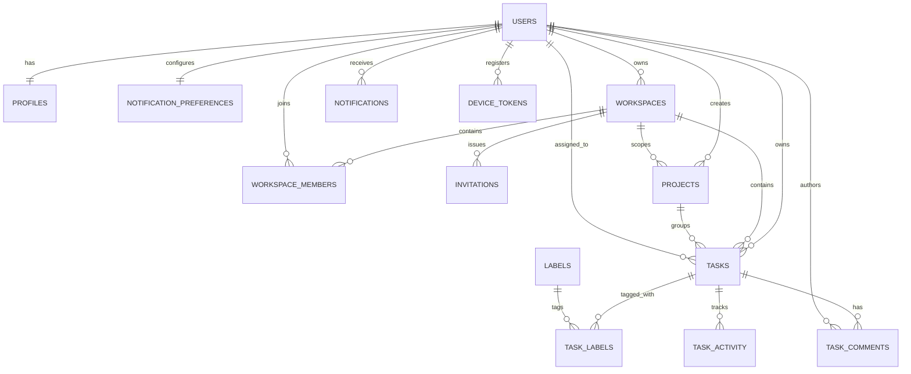

# Taskora Database Architecture & Schema Specification (DATABASE.md)

**Product:** Taskora  
**Database Engine:** PostgreSQL 15+ (Supabase)  
**Security Model:** PostgreSQL Row-Level Security (RLS) enabled on all tables  
**Status:** Production Ready Specification  

---

## 1. Overview & Data Architecture

Taskora implements a relational multi-tenant architecture with personal and workspace isolation. The database guarantees:
- **Zero Cross-Tenant Leakage:** Personal tasks are private to the creator/owner. Team workspace tasks are governed strictly by workspace membership and role policies.
- **Automated Lifecycle Hooks:** Automatic profile creation and notification preferences initialization upon authentication via Supabase Auth triggers.
- **Automated Timestamp Management:** Automatic `updated_at` timestamp updates on modified records.
- **Optimized Query Indexing:** Covering composite indexes for frequent queries (due dates, statuses, assignees, project associations).

---

## 2. Entity Relationship Diagram (ERD)



---

## 3. Schema Definitions

### 3.1 Extensions
```sql
CREATE EXTENSION IF NOT EXISTS "uuid-ossp";
CREATE EXTENSION IF NOT EXISTS "pgcrypto";
```

### 3.2 Tables

#### `profiles`
User profile details tied directly to Supabase Auth (`auth.users`).
```sql
CREATE TABLE public.profiles (
    id UUID PRIMARY KEY REFERENCES auth.users(id) ON DELETE CASCADE,
    display_name TEXT,
    avatar_url TEXT,
    timezone TEXT DEFAULT 'UTC' NOT NULL,
    theme TEXT DEFAULT 'system' CHECK (theme IN ('system', 'light', 'dark')),
    created_at TIMESTAMPTZ DEFAULT timezone('utc'::text, now()) NOT NULL,
    updated_at TIMESTAMPTZ DEFAULT timezone('utc'::text, now()) NOT NULL
);
```

#### `workspaces`
Container for collaborative teamwork.
```sql
CREATE TABLE public.workspaces (
    id UUID PRIMARY KEY DEFAULT gen_random_uuid(),
    name TEXT NOT NULL CHECK (char_length(trim(name)) > 0),
    owner_id UUID NOT NULL REFERENCES auth.users(id) ON DELETE CASCADE,
    created_at TIMESTAMPTZ DEFAULT timezone('utc'::text, now()) NOT NULL,
    updated_at TIMESTAMPTZ DEFAULT timezone('utc'::text, now()) NOT NULL
);
```

#### `workspace_members`
Association between workspaces and users with role definitions.
```sql
CREATE TABLE public.workspace_members (
    id UUID PRIMARY KEY DEFAULT gen_random_uuid(),
    workspace_id UUID NOT NULL REFERENCES public.workspaces(id) ON DELETE CASCADE,
    user_id UUID NOT NULL REFERENCES auth.users(id) ON DELETE CASCADE,
    role TEXT NOT NULL DEFAULT 'member' CHECK (role IN ('owner', 'admin', 'member')),
    joined_at TIMESTAMPTZ DEFAULT timezone('utc'::text, now()) NOT NULL,
    CONSTRAINT uq_workspace_member UNIQUE (workspace_id, user_id)
);
```

#### `invitations`
Invitations to collaborate in a workspace.
```sql
CREATE TABLE public.invitations (
    id UUID PRIMARY KEY DEFAULT gen_random_uuid(),
    workspace_id UUID NOT NULL REFERENCES public.workspaces(id) ON DELETE CASCADE,
    email TEXT NOT NULL,
    role TEXT NOT NULL DEFAULT 'member' CHECK (role IN ('admin', 'member')),
    invited_by UUID NOT NULL REFERENCES auth.users(id) ON DELETE CASCADE,
    token_hash TEXT NOT NULL,
    expires_at TIMESTAMPTZ NOT NULL,
    accepted_at TIMESTAMPTZ,
    created_at TIMESTAMPTZ DEFAULT timezone('utc'::text, now()) NOT NULL
);
```

#### `projects`
Projects for organizing tasks.
```sql
CREATE TABLE public.projects (
    id UUID PRIMARY KEY DEFAULT gen_random_uuid(),
    workspace_id UUID REFERENCES public.workspaces(id) ON DELETE CASCADE,
    owner_id UUID NOT NULL REFERENCES auth.users(id) ON DELETE CASCADE,
    name TEXT NOT NULL CHECK (char_length(trim(name)) > 0),
    description TEXT,
    color TEXT DEFAULT '#6366f1',
    is_archived BOOLEAN DEFAULT false NOT NULL,
    created_at TIMESTAMPTZ DEFAULT timezone('utc'::text, now()) NOT NULL,
    updated_at TIMESTAMPTZ DEFAULT timezone('utc'::text, now()) NOT NULL
);
```

#### `tasks`
The core task entity.
```sql
CREATE TABLE public.tasks (
    id UUID PRIMARY KEY DEFAULT gen_random_uuid(),
    owner_id UUID NOT NULL REFERENCES auth.users(id) ON DELETE CASCADE,
    workspace_id UUID REFERENCES public.workspaces(id) ON DELETE SET NULL,
    project_id UUID REFERENCES public.projects(id) ON DELETE SET NULL,
    assignee_id UUID REFERENCES auth.users(id) ON DELETE SET NULL,
    title TEXT NOT NULL CHECK (char_length(trim(title)) > 0),
    description TEXT,
    status TEXT NOT NULL DEFAULT 'todo' CHECK (status IN ('todo', 'in_progress', 'completed', 'cancelled')),
    priority TEXT NOT NULL DEFAULT 'medium' CHECK (priority IN ('low', 'medium', 'high', 'urgent')),
    due_at TIMESTAMPTZ,
    planned_for DATE,
    completed_at TIMESTAMPTZ,
    recurrence_rule TEXT,
    created_at TIMESTAMPTZ DEFAULT timezone('utc'::text, now()) NOT NULL,
    updated_at TIMESTAMPTZ DEFAULT timezone('utc'::text, now()) NOT NULL
);
```

#### `labels` & `task_labels`
Tags for flexible categorization.
```sql
CREATE TABLE public.labels (
    id UUID PRIMARY KEY DEFAULT gen_random_uuid(),
    owner_id UUID REFERENCES auth.users(id) ON DELETE CASCADE,
    workspace_id UUID REFERENCES public.workspaces(id) ON DELETE CASCADE,
    name TEXT NOT NULL CHECK (char_length(trim(name)) > 0),
    color TEXT DEFAULT '#64748b' NOT NULL,
    created_at TIMESTAMPTZ DEFAULT timezone('utc'::text, now()) NOT NULL
);

CREATE TABLE public.task_labels (
    task_id UUID NOT NULL REFERENCES public.tasks(id) ON DELETE CASCADE,
    label_id UUID NOT NULL REFERENCES public.labels(id) ON DELETE CASCADE,
    PRIMARY KEY (task_id, label_id)
);
```

#### `task_comments` & `task_activity`
Audit trail and collaboration dialogues.
```sql
CREATE TABLE public.task_comments (
    id UUID PRIMARY KEY DEFAULT gen_random_uuid(),
    task_id UUID NOT NULL REFERENCES public.tasks(id) ON DELETE CASCADE,
    author_id UUID NOT NULL REFERENCES auth.users(id) ON DELETE CASCADE,
    body TEXT NOT NULL CHECK (char_length(trim(body)) > 0),
    created_at TIMESTAMPTZ DEFAULT timezone('utc'::text, now()) NOT NULL,
    updated_at TIMESTAMPTZ DEFAULT timezone('utc'::text, now()) NOT NULL
);

CREATE TABLE public.task_activity (
    id UUID PRIMARY KEY DEFAULT gen_random_uuid(),
    task_id UUID NOT NULL REFERENCES public.tasks(id) ON DELETE CASCADE,
    actor_id UUID NOT NULL REFERENCES auth.users(id) ON DELETE CASCADE,
    event_type TEXT NOT NULL,
    metadata JSONB DEFAULT '{}'::jsonb NOT NULL,
    created_at TIMESTAMPTZ DEFAULT timezone('utc'::text, now()) NOT NULL
);
```

#### `notifications`, `notification_preferences`, `device_tokens`
Smart alerts and multi-channel messaging.
```sql
CREATE TABLE public.notifications (
    id UUID PRIMARY KEY DEFAULT gen_random_uuid(),
    user_id UUID NOT NULL REFERENCES auth.users(id) ON DELETE CASCADE,
    type TEXT NOT NULL,
    title TEXT NOT NULL,
    body TEXT,
    related_task_id UUID REFERENCES public.tasks(id) ON DELETE SET NULL,
    read_at TIMESTAMPTZ,
    created_at TIMESTAMPTZ DEFAULT timezone('utc'::text, now()) NOT NULL
);

CREATE TABLE public.notification_preferences (
    user_id UUID PRIMARY KEY REFERENCES auth.users(id) ON DELETE CASCADE,
    email_enabled BOOLEAN DEFAULT true NOT NULL,
    push_enabled BOOLEAN DEFAULT false NOT NULL,
    daily_summary_enabled BOOLEAN DEFAULT false NOT NULL,
    quiet_hours_start TIME DEFAULT '22:00:00',
    quiet_hours_end TIME DEFAULT '07:00:00',
    timezone TEXT DEFAULT 'UTC' NOT NULL,
    updated_at TIMESTAMPTZ DEFAULT timezone('utc'::text, now()) NOT NULL
);

CREATE TABLE public.device_tokens (
    id UUID PRIMARY KEY DEFAULT gen_random_uuid(),
    user_id UUID NOT NULL REFERENCES auth.users(id) ON DELETE CASCADE,
    token TEXT NOT NULL,
    platform TEXT NOT NULL,
    created_at TIMESTAMPTZ DEFAULT timezone('utc'::text, now()) NOT NULL,
    last_seen_at TIMESTAMPTZ DEFAULT timezone('utc'::text, now()) NOT NULL,
    CONSTRAINT uq_user_device_token UNIQUE (user_id, token)
);
```

---

## 4. Performance Indexes

```sql
-- Tasks indexes
CREATE INDEX idx_tasks_owner_id ON public.tasks(owner_id);
CREATE INDEX idx_tasks_workspace_id ON public.tasks(workspace_id);
CREATE INDEX idx_tasks_project_id ON public.tasks(project_id);
CREATE INDEX idx_tasks_assignee_id ON public.tasks(assignee_id);
CREATE INDEX idx_tasks_status ON public.tasks(status);
CREATE INDEX idx_tasks_due_at ON public.tasks(due_at);
CREATE INDEX idx_tasks_planned_for ON public.tasks(planned_for);
CREATE INDEX idx_tasks_completed_at ON public.tasks(completed_at);
CREATE INDEX idx_tasks_created_at ON public.tasks(created_at);

-- Projects indexes
CREATE INDEX idx_projects_workspace_id ON public.projects(workspace_id);
CREATE INDEX idx_projects_owner_id ON public.projects(owner_id);

-- Workspace members
CREATE INDEX idx_workspace_members_user_id ON public.workspace_members(user_id);
CREATE INDEX idx_workspace_members_ws_id ON public.workspace_members(workspace_id);

-- Comments & Activity
CREATE INDEX idx_task_comments_task_id ON public.task_comments(task_id);
CREATE INDEX idx_task_activity_task_id ON public.task_activity(task_id);

-- Notifications
CREATE INDEX idx_notifications_user_unread ON public.notifications(user_id, read_at) WHERE read_at IS NULL;
```

---

## 5. Row-Level Security (RLS) Policies

All tables have RLS enabled:
```sql
ALTER TABLE public.profiles ENABLE ROW LEVEL SECURITY;
ALTER TABLE public.workspaces ENABLE ROW LEVEL SECURITY;
ALTER TABLE public.workspace_members ENABLE ROW LEVEL SECURITY;
ALTER TABLE public.invitations ENABLE ROW LEVEL SECURITY;
ALTER TABLE public.projects ENABLE ROW LEVEL SECURITY;
ALTER TABLE public.tasks ENABLE ROW LEVEL SECURITY;
ALTER TABLE public.labels ENABLE ROW LEVEL SECURITY;
ALTER TABLE public.task_labels ENABLE ROW LEVEL SECURITY;
ALTER TABLE public.task_comments ENABLE ROW LEVEL SECURITY;
ALTER TABLE public.task_activity ENABLE ROW LEVEL SECURITY;
ALTER TABLE public.notifications ENABLE ROW LEVEL SECURITY;
ALTER TABLE public.notification_preferences ENABLE ROW LEVEL SECURITY;
ALTER TABLE public.device_tokens ENABLE ROW LEVEL SECURITY;
```

### Security Helper Functions
Using `SECURITY DEFINER` functions prevents recursion when policies query membership tables:

```sql
CREATE OR REPLACE FUNCTION public.is_workspace_member(ws_id UUID, uid UUID)
RETURNS BOOLEAN
LANGUAGE sql
SECURITY DEFINER
STABLE
AS $$
    SELECT EXISTS (
        SELECT 1 FROM public.workspace_members
        WHERE workspace_id = ws_id AND user_id = uid
    );
$$;

CREATE OR REPLACE FUNCTION public.get_workspace_role(ws_id UUID, uid UUID)
RETURNS TEXT
LANGUAGE sql
SECURITY DEFINER
STABLE
AS $$
    SELECT role FROM public.workspace_members
    WHERE workspace_id = ws_id AND user_id = uid;
$$;
```

### Key RLS Rules
- **Profiles:** Publicly readable by authenticated users; updatable only by the owner `auth.uid() = id`.
- **Workspaces:** Visible to members (`is_workspace_member(id, auth.uid())`).
- **Projects:** Visible to owner OR workspace members if `workspace_id` is set.
- **Tasks:** Visible to owner OR assignee OR workspace members if assigned to a workspace.
- **Comments & Activity:** Accessible only if the user has access to the parent task.
- **Notifications & Preferences:** Private strictly to `auth.uid() = user_id`.

---

## 6. Triggers & Automated Functions

### Automatic User Profile & Notification Preferences Initialization
```sql
CREATE OR REPLACE FUNCTION public.handle_new_user()
RETURNS TRIGGER
LANGUAGE plpgsql
SECURITY DEFINER
AS $$
BEGIN
    INSERT INTO public.profiles (id, display_name, avatar_url)
    VALUES (
        NEW.id,
        COALESCE(NEW.raw_user_meta_data->>'full_name', NEW.raw_user_meta_data->>'name', split_part(NEW.email, '@', 1)),
        NEW.raw_user_meta_data->>'avatar_url'
    )
    ON CONFLICT (id) DO NOTHING;

    INSERT INTO public.notification_preferences (user_id)
    VALUES (NEW.id)
    ON CONFLICT (user_id) DO NOTHING;

    RETURN NEW;
END;
$$;

CREATE OR REPLACE TRIGGER on_auth_user_created
    AFTER INSERT ON auth.users
    FOR EACH ROW
    EXECUTE FUNCTION public.handle_new_user();
```

### Automatic `updated_at` Timestamp
```sql
CREATE OR REPLACE FUNCTION public.set_updated_at()
RETURNS TRIGGER
LANGUAGE plpgsql
AS $$
BEGIN
    NEW.updated_at = timezone('utc'::text, now());
    RETURN NEW;
END;
$$;

CREATE TRIGGER trg_profiles_updated_at BEFORE UPDATE ON public.profiles FOR EACH ROW EXECUTE FUNCTION public.set_updated_at();
CREATE TRIGGER trg_workspaces_updated_at BEFORE UPDATE ON public.workspaces FOR EACH ROW EXECUTE FUNCTION public.set_updated_at();
CREATE TRIGGER trg_projects_updated_at BEFORE UPDATE ON public.projects FOR EACH ROW EXECUTE FUNCTION public.set_updated_at();
CREATE TRIGGER trg_tasks_updated_at BEFORE UPDATE ON public.tasks FOR EACH ROW EXECUTE FUNCTION public.set_updated_at();
CREATE TRIGGER trg_task_comments_updated_at BEFORE UPDATE ON public.task_comments FOR EACH ROW EXECUTE FUNCTION public.set_updated_at();
CREATE TRIGGER trg_notification_preferences_updated_at BEFORE UPDATE ON public.notification_preferences FOR EACH ROW EXECUTE FUNCTION public.set_updated_at();
```
